<picture>
  <source media="(prefers-color-scheme: dark)" srcset="./assets/singularity-hero-dark.svg">
  
</picture>

<b>Manideep Koleti</b> · BTech student | Exploring AI, Full Stack &amp; Automation

 

#### Telemetry

<picture>
  <source media="(prefers-color-scheme: dark)" srcset="./assets/singularity-telemetry-dark.svg">
  
</picture>

Reading the instruments

- **Accretion disk:** one particle per day of the last year; brighter and closer to the hole means a busier day. Inner rings orbit faster, as they would around a real black hole.
- **Orbit:** contributions per month, plotted as a closed trajectory; the beacon marks the busiest month.
- **Spectral composition:** language share by bytes across public repositories.
- **Light theme:** rendered as a photographic negative, the way astronomical survey plates were printed.

Artwork: original animated SVG, generated by README Templates · template: Singularity. Motion stops if your system asks for reduced motion.

#### Flight log

- `MSN-01` **[LLM-Powered-DevOps-Assistant-for-CI-CD-Automation](https://github.com/Money043/LLM-Powered-DevOps-Assistant-for-CI-CD-Automation)** · LLM-powered DevOps assistant that analyzes build logs, identifies root causes, and suggests actionable fixes in seconds. Built with FastAPI, Groq, and Llama 3.3 70B, optimized for low latency and CI/CD integration.  
  CSS · ★ 1
- `MSN-02` **[autonomous-campus-shuttle](https://github.com/Money043/autonomous-campus-shuttle)** · 3D Autonomous Campus Shuttle Simulation built with Python & Panda3D  
  Python · ★ 1
- `MSN-03` **[BR-Chatbot](https://github.com/Money043/BR-Chatbot)**  
  TypeScript
- `MSN-04` **[JPL-Internship-Projects](https://github.com/Money043/JPL-Internship-Projects)**  
  Python

<picture>
  <source media="(prefers-color-scheme: dark)" srcset="./assets/singularity-end-dark.svg">
  
</picture>

